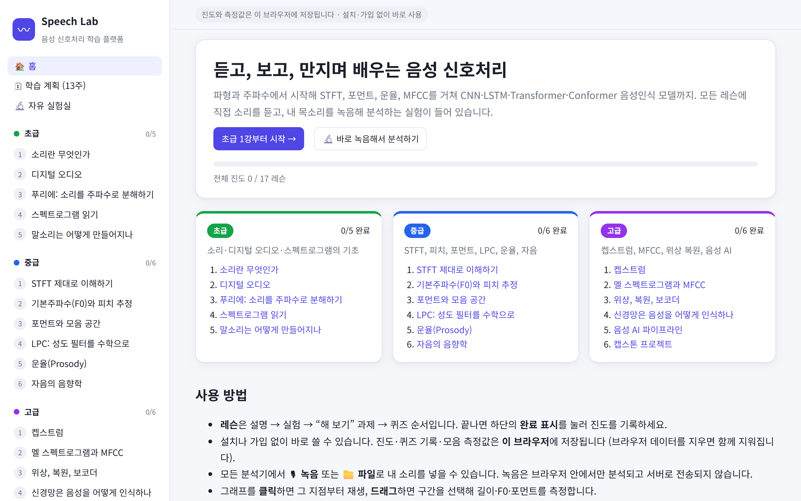
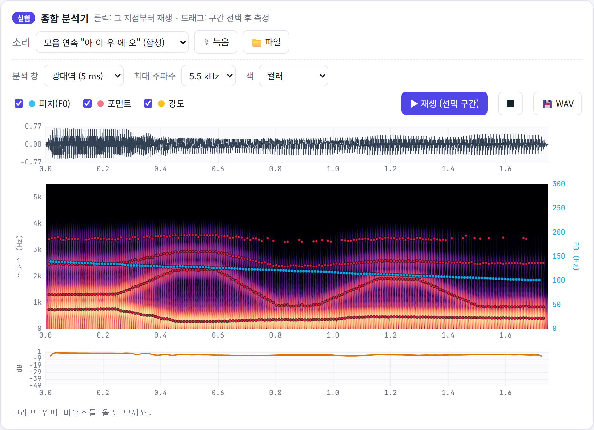
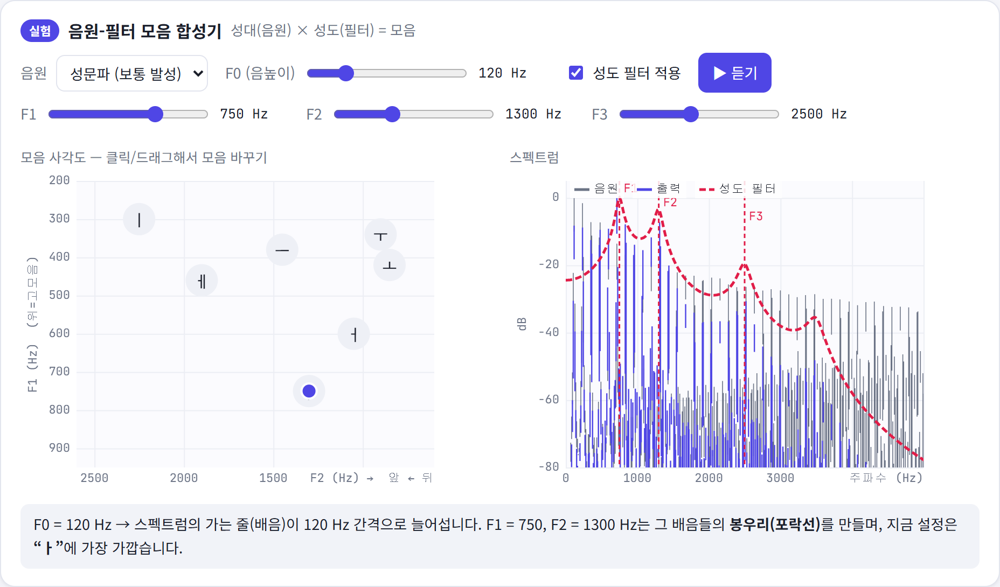
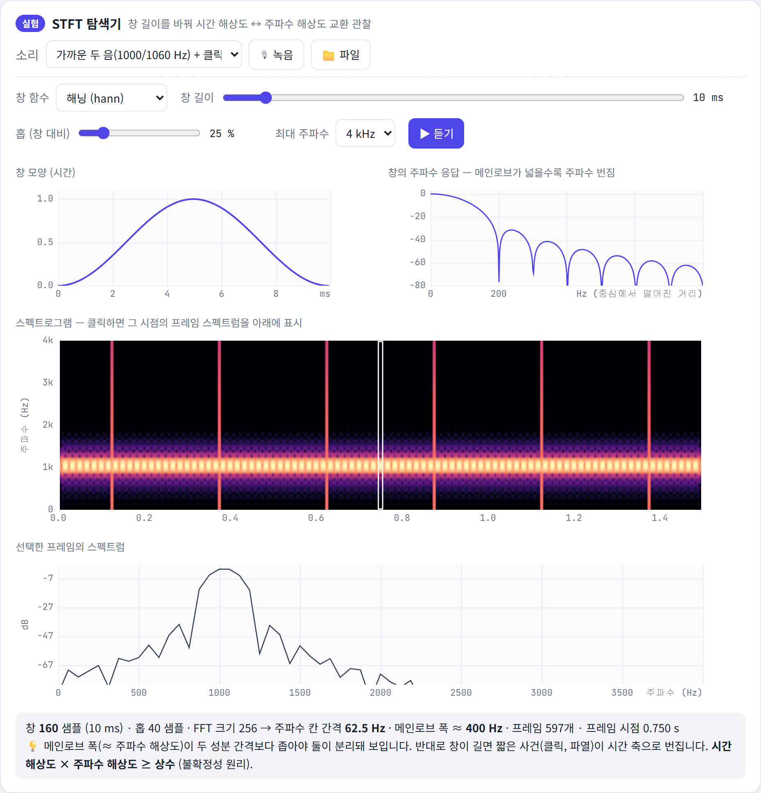
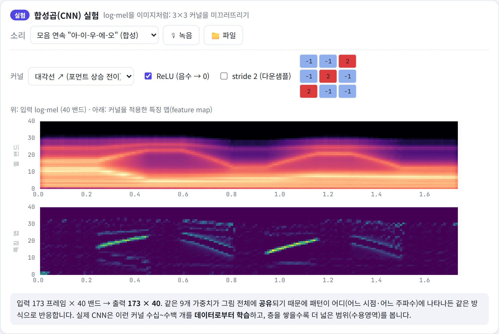
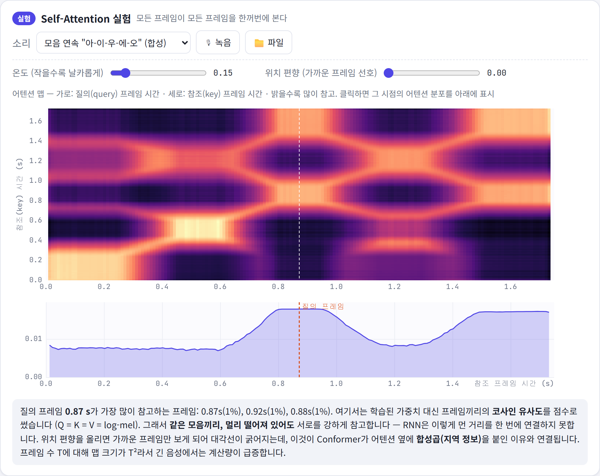
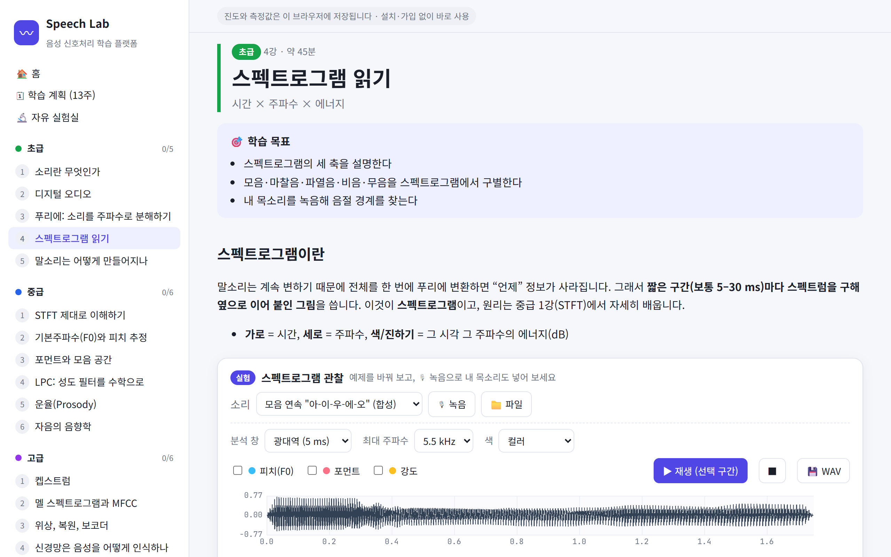

# 〰 Speech Lab

### 듣고, 보고, 만지며 배우는 음성 신호처리

파형과 주파수에서 시작해 STFT · 포먼트 · 운율 · MFCC를 거쳐 
CNN · LSTM · Transformer · Conformer 음성인식 모델까지

### **[▶ 사이트 바로가기](https://choiyoonsou.github.io/speech-lab-showcase/)**
설치·가입 없이 브라우저에서 바로 사용 (Chrome · Edge 권장)

## 소개

**Speech Lab**은 음성 신호처리를 처음 배우는 사람부터 음성 AI를 공부하는 사람까지,
개념을 **귀로 듣고 → 그림으로 보고 → 숫자로 측정**하며 익히도록 만든 웹 학습 플랫폼입니다.

- 📚 **19개 인터랙티브 레슨** — 초급 6 · 중급 6 · 고급 7, 레슨마다 설명 → 실험 → 과제 → 퀴즈
- 🎙 **내 목소리로 실습** — 녹음하거나 파일을 열면 스펙트로그램 · 피치 · 포먼트 · 강도를 바로 분석
- 🔬 **16가지 실험 도구** — 모음 합성기, STFT 탐색기, SNR·SI-SNR, LPC, VOT, MFCC, Griffin-Lim, LSTM 게이트, 어텐션 계산기 등
- 🗓 **13주 학습 계획** — 주차별 레슨과 Praat · Python 실습 과제
- 💾 **진도 저장** — 완료한 레슨 · 퀴즈 기록 · 모음 측정값이 브라우저에 저장되어 다음에 이어서 학습
- 🔒 **개인정보 보호** — 모든 분석이 브라우저 안에서 이루어지며, 녹음한 소리는 어디로도 전송되지 않음

## 화면

### 음성 분석기
파형 · 스펙트로그램 · 피치(F0) · 포먼트 · 강도를 한 화면에서. 클릭하면 그 지점부터 재생하고, 드래그하면 구간의 길이 · F0 · F1 · F2를 측정합니다.

### 음원-필터 모음 합성기
모음 사각도를 클릭하면 그 모음이 합성되어 들립니다. 성대(음원) × 성도(필터) = 모음이라는 원리를 스펙트럼으로 확인합니다.

### STFT 탐색기
창 길이와 창 함수를 바꾸며 시간 해상도와 주파수 해상도의 트레이드오프를 직접 봅니다.

### 신경망은 음성을 어떻게 인식하나
내 녹음의 log-mel에 합성곱 커널을 적용하면 포먼트 전이가 빛나고, Self-Attention 맵에서는 같은 모음끼리 멀리 떨어져 있어도 서로를 참고하는 모습이 보입니다.

| CNN 특징 맵 | Self-Attention 맵 |
|---|---|
|  |  |

### 레슨 화면

## 커리큘럼

| 단계 | 레슨 |
|---|---|
| **초급** 소리와 디지털 오디오의 기초 | 소리란 무엇인가 · 디지털 오디오 · 레벨과 음질 지표 (Peak · RMS · dBFS · 클리핑 · SNR · SI-SNR) · 푸리에: 소리를 주파수로 분해하기 · 스펙트로그램 읽기 · 말소리는 어떻게 만들어지나 |
| **중급** 음성 분석의 핵심 도구 | STFT 제대로 이해하기 · 기본주파수(F0)와 피치 추정 · 포먼트와 모음 공간 · LPC: 성도 필터를 수학으로 · 운율(Prosody) · 자음의 음향학 |
| **고급** 특징 추출에서 딥러닝까지 | 켑스트럼 · 멜 스펙트로그램과 MFCC · 위상, 복원, 보코더 · 딥러닝 쉽게 이해하기 (비유와 손계산으로 CNN · RNN · LSTM · GRU · Attention · Transformer) · 신경망은 음성을 어떻게 인식하나 (CNN → LSTM/GRU → Transformer → Conformer, CTC) · 음성 AI 파이프라인 · 캡스톤 프로젝트 |

## 기술 스택

| 영역 | 사용 기술 |
|---|---|
| 프론트엔드 | React 18, TypeScript, Vite, React Router |
| 신호처리 | FFT, STFT, 자기상관 피치 추정, LPC 포먼트 분석, 멜 필터뱅크 · MFCC, 켑스트럼, Griffin-Lim — 외부 라이브러리 없이 직접 구현해 브라우저에서 실행 |
| 배포 | GitHub Pages (서버 없이 동작하는 정적 사이트) |

---

이 저장소는 프로젝트 소개용이며, 소스 코드는 비공개입니다.

© 2026 **[Choiyoonsou](https://github.com/Choiyoonsou)** · All rights reserved 
레슨 콘텐츠는 [CC BY-NC 4.0](https://creativecommons.org/licenses/by-nc/4.0/deed.ko)

